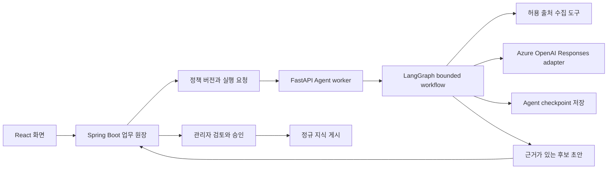

# ArchDeck AI Agent 아키텍처와 최신 기술 검토

검토 기준일: 2026-11-27 · 상태: 공식 자료 기반 설계 제안, 실제 수집·모델 호출·프로덕션 통합 전

## 결론과 적용 범위

ArchDeck Agent는 정한 분야의 정보를 모아 근거 있는 지식 초안을 만드는 작업 서버로 설계한다. 초기 분야는 기존 인증·보안·웹 아키텍처에 AI 에이전트를 더한다. 분야·출처·기간·제외 조건은 코드 enum 대신 버전 있는 설정으로 확장한다. 모델 공급자는 기존 DWP 운영 방식의 Azure OpenAI를 기본으로 하고 교체 가능한 provider 계약을 둔다.

권고 조합은 **Python FastAPI·Pydantic + LangGraph 한 개의 오케스트레이션 + Azure OpenAI v1 Responses provider adapter + PostgreSQL checkpoint**다. BE는 정책·스케줄·실행 원장·검토·게시를 소유하고 Agent는 허용된 수집·추론·검증 단계를 수행한다. 기존 Spring Boot, React·TypeScript·Tailwind와 사내 ADMIN·READER를 유지한다.

하네스 엔지니어링은 실행 환경·도구·문맥·제약·평가·피드백을 함께 설계하는 접근으로 적용한다. 문서에서 확인한 최신 방향은 이 구조의 지속 실행, 관측·평가, 세션과 실행 환경 분리다. 확인한 공식 자료는 이를 대체하는 단일한 ‘하네스 이후 표준’을 제시하지 않는다. 새로운 이름보다 실패·재시작·근거·비용을 통제할 수 있는지를 선택 기준으로 삼는다.

## 확인한 공식 동향과 날짜

| 자료 | 날짜와 확인 범위 | ArchDeck에 반영할 판단 |
|---|---|---|
| [OpenAI Harness engineering](https://openai.com/index/harness-engineering/) | 게시 2026-02-11. 에이전트가 일할 환경과 피드백 루프, 저장소 지식·규칙의 가시성을 다룬다. | 프롬프트만 저장하지 않고 정책·도구 계약·fixture·eval·버전·실행 근거를 함께 관리한다. 해당 글의 코딩 에이전트 실험 수치를 콘텐츠 수집 제품의 성능으로 옮기지 않는다. |
| [Anthropic Effective harnesses](https://www.anthropic.com/research/effective-harnesses-for-long-running-agents) | 게시 2025-11-26. 세션 사이 진행 정보를 남기고 작은 검증 단위로 이어가는 문제를 다룬다. | 수집 항목과 완료 단계를 체크포인트로 보존하고 재시작 시 처음부터 무제한 재수행하지 않는다. |
| [Anthropic Context engineering](https://www.anthropic.com/research/effective-context-engineering-for-ai-agents) | 게시 2025-09-29. 필요한 문맥을 선택·정제하고 긴 작업의 문맥을 관리하는 접근이다. | 분야별 참고 규칙과 필요한 evidence만 단계별로 전달한다. 이 자료의 날짜는 위 하네스 자료보다 앞이므로 ‘하네스보다 나중에 나온 대체 기술’로 소개하지 않는다. |
| [Anthropic Managed Agents](https://www.anthropic.com/research/managed-agents) | 게시 2026-04-08. session log, harness, sandbox를 분리해 각각 교체·복구하는 구조를 설명한다. | 상태는 컨테이너 밖에 보존하고 실행기는 재시작 가능하게 한다. 이 설계 원리를 참고하며 관리형 서비스 구독을 MVP 전제로 삼지 않는다. |
| [OpenAI Agents API architecture](https://developers.openai.com/api/docs/guides/agents-api/architecture) | 2026-11-27 열람한 현행 문서. OpenAI가 harness를 실행하고 환경은 필요에 따라 붙이는 구조다. 문서의 게시일을 임의로 추정하지 않는다. | 관리형 agent runtime을 장기 대안으로 둔다. 현재는 업무 원장과 수집 정책을 로컬 서비스에서 통제하는 구성을 우선한다. |
| [LangChain Deep Agents](https://docs.langchain.com/oss/python/deepagents/overview) | 2026-11-27 열람. 계획·가상 파일시스템·하위 에이전트·기억을 LangChain/LangGraph 위에 더한 agent harness로 정의한다. | 복잡한 탐색에 유용한 후보지만 정해진 수집 흐름의 최초 구현에는 직접 LangGraph를 사용한다. Deep Agents를 하네스의 폐기·대체 표준으로 표현하지 않는다. |

위 날짜는 원문 게시일과 문서 열람일을 구분한 것이다. 라이브러리의 정확한 설치 버전은 구현 시 공식 지원 상태와 취약점·호환성을 확인해 lock 파일에 고정한다.

## 프레임워크와 런타임 비교

| 후보 | 공식 기능에서 확인한 강점 | 비용·통합 판단 | 최초 선택 |
|---|---|---|---|
| LangGraph | checkpoint·중단/재개·분기와 노드별 오류 처리를 조합할 수 있다. | BE 원장을 유지하면서 단계 상태만 Agent에 맡기기 좋다. checkpoint 저장·worker 운영은 직접 구성한다. | 채택 |
| OpenAI Agents SDK | 도구 실행·handoff·세션·사람 개입과 tracing을 제공한다. | OpenAI 계열 제품에 적합한 대안이다. Azure 배포의 기능 지원은 별도 확인 대상이다. 이미 LangGraph로 흐름을 제어하므로 두 agent loop를 함께 넣지 않는다. | 대안으로 보존 |
| Temporal | workflow history와 Activities로 외부 작업을 지속 실행한다. 현재 OpenAI Agents SDK 통합도 제공한다. | 다수 서비스·장기 workflow·운영 복구가 커질 때 검토한다. 소형 PC MVP에 Temporal 서버와 다른 오케스트레이터를 함께 추가하지 않는다. | 확장 시 재평가 |
| 관리형 Agents API·Managed Agents | 공급자가 harness·세션·환경 운영의 일부를 맡는다. | 데이터 반출·비용·관측·운영 정책을 수용할 수 있을 때 운영 위임 대안이다. BE와 managed session 중 어느 쪽이 업무 상태의 원장인지 다시 정해야 한다. | 후속 대안 |

LangGraph 근거: [Persistence](https://docs.langchain.com/oss/python/langgraph/persistence), [Fault tolerance](https://docs.langchain.com/oss/python/langgraph/fault-tolerance), [Interrupts](https://docs.langchain.com/oss/python/langgraph/interrupts).

SDK 근거: [OpenAI Agents SDK](https://openai.github.io/openai-agents-python/), [HITL](https://openai.github.io/openai-agents-python/human_in_the_loop/). Temporal 근거: [공식 integration](https://docs.temporal.io/develop/python/integrations/openai-agents), [2026-11-18 갱신 Cookbook](https://docs.temporal.io/ai/cookbook/openai-agents-sdk-python).

Temporal 자료는 통합을 지원한다는 근거이며 ArchDeck에서 같은 규모·복구 성능을 시험했다는 의미가 아니다. 최초 구현에서 LangGraph와 Temporal을 이중 원장으로 쌓지 않는다.

## 보완 기술과 도입 기준

| 기술·개념 | 역할 | ArchDeck 적용 |
|---|---|---|
| Context engineering | 단계마다 적절한 정책·문서·근거를 구성 | 필수 원칙. 전체 기사와 모든 과거 실행을 한 문맥에 넣지 않는다. |
| Evals·observability | 결과와 실행 과정을 재현·평가 | 필수. 프롬프트·모델 변경 시 같은 fixture 평가와 비용·실패율을 비교한다. |
| MCP | 모델이 사용할 도구·문맥의 교환 계약 | 재사용할 수집 커넥터가 필요할 때 도입한다. 최초 직접 HTTP/RSS adapter에는 필수로 넣지 않는다. |
| A2A | 서로 독립된 에이전트 서비스의 능력·작업 교환 | 외부 에이전트 연합 요구가 생길 때 검토한다. FE·BE·Agent가 세 저장소라는 이유만으로 도입하지 않는다. |
| Agent Skills | 필요할 때 읽을 도메인 지침·자원 묶음 | 검토된 내부 정책·예제를 버전으로 보관하는 패턴을 활용한다. 외부 기사나 다운로드한 skill을 실행 지침으로 신뢰하지 않는다. |
| RAG·vector search | 기존 지식을 찾아 문맥에 제공 | 최초에는 출처·내용 hash·일반 검색으로 중복과 연관 항목을 찾는다. 의미 검색의 평가 이득이 확인되면 vector 기능을 추가한다. |

MCP 공식 설명은 문맥 교환 범위를 다루며 LLM 사용·문맥 관리 방식을 정하지 않는다고 명시한다. 현재 architecture 주소는 2026-07-28 버전 문서로 연결되었다. 이는 날짜가 더 최근이어도 harness를 대체하는 오케스트레이션 표준이라는 뜻은 아니다. [MCP Architecture](https://modelcontextprotocol.io/docs/learn/architecture)

A2A와 Skills의 역할 근거: [A2A specification](https://a2a-protocol.org/latest/specification/), [Agent Skills](https://agentskills.io/what-are-skills). 해당 표의 적용 여부는 공식 요구사항이 아닌 ArchDeck의 설계 판단이다.

## 권장 실행 구조

Agent 내부 단계는 발견 → 수집 → 정규화 → 중복 판별 → 근거 추출 → 지식 초안 → 규칙 검증 → BE 후보 제출로 둔다. HTML 수집·정규화·ID 중복·날짜 검사에는 결정적 코드를 사용하고, 주제 관련성·요약·관계 제안처럼 판단이 필요한 구간에 모델을 사용한다. 각 단계의 입력·출력과 실패 코드를 명시한다.

분야별 에이전트는 최초에 서로 다른 서버·거대한 다중 에이전트 팀을 뜻하지 않는다. 같은 graph와 도구에 분야 정책·프롬프트·허용 출처를 주입해 실행한다. 한 분야를 추가해도 공통 실행 제어와 검증 코드를 복제하지 않는다. 별도 검토 모델은 평가로 품질 이득이 확인될 때 제한적으로 추가한다.

BE가 실제 정책·스케줄·실행 lease·검토·정규 콘텐츠 게시의 유일 원장이다. Agent가 자기 일정·게시 상태를 독립적으로 확정하지 않는다. Agent checkpoint는 별도 agent_runtime schema/접속 역할로 격리하며 앱 계정·정규 콘텐츠 테이블에 직접 쓰지 않는다. 실행 상태의 세부 계약과 데이터는 데이터 설계 문서와 맞춘다.

LangGraph의 중단/재개 기능은 예외 처리나 추가 입력을 기다리는 작업에 사용할 수 있다. 게시 승인 자체는 BE의 검토 레코드에 기록한다. 정상 수집 graph는 후보 제출로 작업을 마치고 관리자 검토가 끝날 때까지 worker를 점유하지 않는다.

## DWP 호환 Azure OpenAI와 공급자 교체

도메인 코드가 OpenAI 응답 객체에 직접 의존하지 않게 ModelGateway 계약을 둔다. 입력은 task kind·evidence·정책·출력 schema·예산·취소 정보이며, 출력은 구조화 결과·refusal/incomplete/error·사용량·외부 response ID다. Azure OpenAI v1 Responses adapter를 최초 구현하고 같은 계약에 public OpenAI·다른 공급자·로컬 fixture를 연결할 수 있게 한다.

DWP에서 이미 운영하는 방식에 맞춰 Azure endpoint의 /openai/v1/responses와 API key 인증을 사용한다. 모델 문자열은 공개 모델명이 아니라 해당 Azure 리소스의 배포명이다. ARCHDECK 전용 설정을 우선하고 DWP 설정명은 호환 alias로 처리한다. 기존 AZURE_OPENAI_ENDPOINT·AZURE_OPENAI_API_KEY와 DWP_MODEL_PROVIDER·DWP_OPENAI_MODEL의 역할을 유지하되 자격증명은 실행 프로세스에만 주입하고 파일·Git·화면·로그에 복사하지 않는다.

DWP 현행 v1 요청에는 별도의 api-version query를 붙이지 않는다. Microsoft 문서는 v1과 지역·배포 지원 확인을 안내하므로 Responses, structured output, reasoning 매개변수와 web search의 실제 가용성은 대상 Azure 리소스별 capability probe로 확인한다. public OpenAI의 managed Agents API·sandbox·검색 도구를 Azure에서도 같은 이름·방식으로 제공한다고 가정하지 않는다. probe가 끝나지 않은 기능은 비활성 상태로 둔다. [Azure Responses 공식 문서](https://learn.microsoft.com/en-us/azure/foundry/openai/how-to/responses?view=foundry-classic), [Azure structured output 공식 문서](https://learn.microsoft.com/en-us/azure/ai-foundry/openai/how-to/structured-outputs?view=foundry-classic)

Structured Outputs는 지원 JSON Schema에 맞는 모델 출력을 제공하지만 거절·미완료·API 오류와 schema 밖의 업무 규칙은 앱이 처리해야 한다. 형식 통과는 사실 검증 통과가 아니다. 인용 URL과 evidence ID가 실제 수집 자료에 존재하는지, 핵심 주장과 출처가 연결되는지 별도로 검사한다. [OpenAI Structured Outputs](https://developers.openai.com/api/docs/guides/structured-outputs)

검색 provider와 모델 provider도 분리한다. 최초 수집은 등록한 RSS·공식 API·허용된 HTML adapter를 우선하고 필요할 때 Azure 배포의 지원이 검증된 web search 또는 별도 검색 provider adapter를 추가한다. 검색에서 찾은 URL도 같은 수집 정책을 통과해야 한다. OpenAI web search를 선택해 웹 검색 정보를 화면에 표시할 때는 제공된 인용을 누락하지 않고 클릭 가능한 출처로 보여 준다. [OpenAI Web search](https://developers.openai.com/api/docs/guides/tools-web-search)

모델 ID·가격·출력 상한을 latest 별칭이나 코드 enum에 고정하지 않는다. 운영 설정에서 승인된 모델을 선택하고 지원·가격 표의 확인일을 기록한다. 초기 서버·테스트는 fixture mode로 키·외부 호출 없이 실행하며, 실모델 활성화와 비용 집행은 명시적 운영 설정이 필요하다.

## ArchDeck 하네스의 실제 구성

| 구성 요소 | 관리할 산출물과 규칙 |
|---|---|
| 정책 | 분야·출처·기간·언어·포함/제외 조건·수집량·비용 상한의 immutable policy snapshot |
| 도구 | 허용된 검색·fetch·본문 추출·근거 조회·후보 제출만 등록. 임의 shell·SQL·파일 실행은 허용하지 않음 |
| 문맥 | 읽기 데이터와 운영 지시를 분리하고 필요한 evidence excerpt만 전달. 게시 지식·정책과 raw 문서를 다른 신뢰 수준으로 취급 |
| 실행 | run ID·정책/graph/prompt/model 버전·입력 hash·checkpoint·attempt·취소·deadline |
| 검증 | 구조·날짜·중복·주장 근거·정책 준수·저작권 보존 범위와 검토 상태 |
| 평가 | 정상·실패·악성 입력 fixture와 변경 전후 quality/cost 비교 |
| 관측 | 단계·시간·도구·입력 크기·token·비용·실패 이유·Azure deployment 식별 정보, 비밀·원문 전문·개인 메모는 기본 trace에서 제외 |
| 복구 | 재시도 분류, durable idempotency key, lease/fence, 취소 확인, DLQ 또는 운영 재처리 |

OpenAI Agents SDK를 대안으로 선택하면 기본 tracing이 활성화되고 민감 데이터 포함 옵션도 별도 관리 대상이므로 외부 trace 전송과 redaction을 먼저 설정해야 한다. LangGraph 선택에서도 외부 tracing 플랫폼은 기본 필수 인프라로 도입하지 않는다. [OpenAI SDK Tracing](https://openai.github.io/openai-agents-python/tracing/)

## 재시작·중복·취소·비용

LangGraph의 retry는 node를 다시 실행하므로 외부 효과를 정확히 한 번 수행하게 만들지 않는다. checkpoint도 함수 중간의 외부 변경을 대신 복구하지 않는다. 인용된 공식 문서의 현재 timeout/error-handler 기능은 LangGraph 1.2 이상 조건을 갖고 있으므로 실제 lock 버전에서 비동기 node·취소 동작을 확인한다. [LangGraph Fault tolerance](https://docs.langchain.com/oss/python/langgraph/fault-tolerance)

- 수집 항목의 canonical URL·본문 hash와 run/단계 ID를 먼저 영속화한다.
- BE 후보 제출은 durable event ID와 fencing token으로 중복·오래된 worker 응답을 거절한다. 제출 성공 응답을 잃어도 새 후보를 무조건 만들지 않고 동일 key 결과를 확인한다.
- 모델 호출 결과를 받았지만 저장하기 전에 죽으면 재호출·추가 비용이 발생할 수 있다. 외부 API가 idempotency를 보장하는지 확인하지 않고 정확히 한 번 과금된다고 약속하지 않는다.
- 매 run에 URL 수·총 수집 byte·node/model 호출 수·token·금액·wall-clock 상한을 필수로 두고 재시도도 같은 전체 예산에서 차감한다.
- timeout은 외부 제공자의 실제 취소·과금 중단 보장이 아니다. 취소 후 도착한 결과는 게시하지 않고 사용량·결과 상태를 기록한다.
- 429·일시 5xx는 제공자의 retry 정보와 bounded backoff를 적용하고, schema·출처·권한 실패는 같은 요청을 무한 재시도하지 않는다.

정확한 기본 상한은 운영 비용 기준을 정할 때 설정한다. 단일 PC에서는 worker 동시 실행을 작게 시작하고 분야 수가 늘어도 같은 전역 비용·동시성 상한을 공유한다.

## 수집과 지식화의 안전 경계

외부 문서·검색 결과·HTML은 신뢰하지 않는 데이터다. 본문에 도구 호출·정책 변경·비밀 전송 지시가 있어도 실행 지시로 승격하지 않는다. 모델 출력은 schema·업무 규칙 검사를 거친 후보이며 게시 권한을 얻지 못한다.

수집기는 http/https·허용 도메인·전송 크기·시간·redirect 횟수를 검사한다. DNS와 redirect의 각 목적지를 확인하고 사설·loopback·metadata 주소와 허용하지 않은 포트를 차단한다. URL 인코딩·자격증명·압축 폭탄·비표준 MIME·과도한 본문도 검사한다. robots·이용 조건·수집 허용 정책과 원문 보존 기간을 출처별로 정한다.

초기에는 script를 실행하지 않는 HTTP fetch와 문서 추출만 사용한다. 브라우저 자동화·PDF/OCR·첨부 실행이 필요해지면 네트워크·파일·자원 한도가 있는 별도 격리 도구로 설계한다. 가져온 코드 예제를 실행하거나 root shell·호스트 디렉터리·Docker socket을 모델에 제공하지 않는다.

## 근거와 최신성의 계약

지식 항목은 URL뿐 아니라 source ID·문서 hash·근거 위치·짧은 발췌와 claim ID를 보존한다. 게시일, 실제 사건일, 원문 수정일, 수집일을 다른 필드로 취급한다. 날짜가 없는 문서를 수집일의 최신 기사로 바꾸지 않는다.

기사의 인기도나 LLM의 confidence는 사실 판정이 아니다. 공식 문서·표준·릴리스와 독립 출처를 구분하고, 상충하는 주장은 해결된 것처럼 합치지 않는다. 수정·철회·후속 버전은 기존 지식의 변경 제안으로 연결한다. 자동 점수는 검토 순서를 돕고 게시 승인을 대신하지 않는다.

## 출시 전 검증 기준

다음은 실행해야 할 수용 조건이며 이번 리서치에서 시험한 결과가 아니다.

1. 정책을 하나 추가해 새로운 분야를 공통 graph로 실행하고 기존 분야와 예산·자료가 섞이지 않는다.
2. 같은 기사 재수집, worker 재시작, 중복 callback에도 후보와 게시가 중복되지 않는다.
3. 미래 날짜·날짜 없음·과거 재게시를 구분하고 정책 기간 밖의 자료를 최신 지식으로 표시하지 않는다.
4. 실제 근거가 없는 claim·없는 URL·반대되는 출처를 validator가 검토 필요로 보낸다.
5. 프롬프트 주입·SSRF·redirect·대형 문서 fixture에서 외부 자료가 도구 권한·정책·게시 권한을 얻지 못한다.
6. 거절·잘린 응답·잘못된 schema·429·timeout·취소와 예산 소진을 재현한다.
7. Agent 프로세스·DB·BE 연결을 끊고 lease·checkpoint·fence·재시도 이력을 확인한다.
8. READER는 게시 지식만 읽고 ADMIN만 정책·실행·검토를 관리하며 Agent는 검토자와 게시자로 가장하지 못한다.
9. 프롬프트·모델·정책 버전 변경 시 같은 평가 세트로 근거 충족·채택/거절·비용·지연을 비교한다.
10. API key가 없는 fixture mode에서는 실제 네트워크 수집·모델 호출·자동 스케줄 실행이 0회다.

초기 모델 품질 목표와 기사량·주기·비용 상한은 정책 pilot 결과를 보고 수치화한다. 이 문서에 특정 공급자의 최신 모델 성능·가격이나 무오류 자동 지식화 성능을 추정해 넣지 않는다.

## 전환 조건

장기 작업이 여러 서비스와 날짜에 걸쳐 이어지고 운영 복구·스케줄·신호 요구가 커지면 Temporal 또는 관리형 runtime으로 오케스트레이션 책임을 옮기는 ADR을 작성한다. 그때 기존 BE 업무 원장과 graph checkpoint의 역할을 재정의하고, 두 scheduler·두 workflow owner를 병행하지 않는다.

임의 탐색·코드 작성·복잡한 workspace 작업이 제품 기능이 되면 Deep Agents·Agents SDK·관리형 sandbox를 재평가한다. 최초 기사 수집·지식 초안에 해당 능력을 미리 열지 않는다. 공식 문서에서 기능이 존재한다는 사실과 ArchDeck에 필요하다는 판단은 구분한다.
