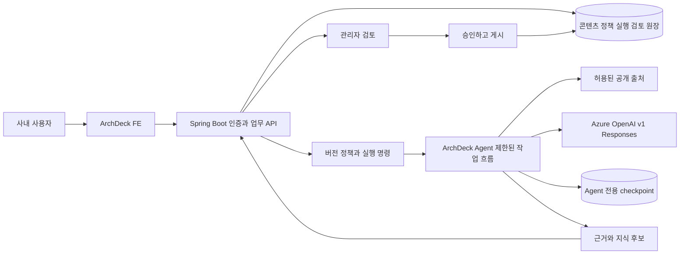

# ArchDeck 리서치 에이전트 통합 계획

기준일: 2026-11-27 · 상태: 추가 설계와 오프라인 실행 골격, 실제 수집·지식 게시 통합 전

## 확정된 방향

사용자는 기존 인증·보안·웹 아키텍처와 AI 에이전트를 초기 수집 분야로 선택했고, 분야 확장성과 범용성을 요구했다. 모델은 기존 dwp_agent에서 사용하는 Azure OpenAI 설정 방식으로 맞춘다. 설정 값이나 키를 새 공개 저장소에 복사하지 않는다.

| 영역 | 선택 |
|---|---|
| 제품 | 수집 문서 → 근거 검토 → 시점성 인사이트 또는 영구 지식 초안 → 관리자 게시 |
| 모델 | Azure OpenAI v1 Responses, DWP 호환 환경변수, 배포명 기반 선택 |
| Agent 기술 | Python 3.14에서 검증한 FastAPI·Pydantic·LangGraph, uv.lock |
| 오케스트레이션 | LangGraph 한 가지. 정해진 흐름과 제한된 모델 호출을 사용 |
| 업무 원장 | BE의 정책 버전·실행·검토·게시·감사 |
| 영속화 목표 | BE 업무 테이블 + 별도 Agent checkpoint 스키마·최소 DB 역할 |
| 현재 저장 | fixture 평가의 InMemorySaver만 구현. 재시작 영속화를 구현한 것이 아님 |
| UI | 기존 학습 6메뉴 + 트렌드·인사이트, ADMIN 리서치 에이전트 |
| 게시 | 관리자만 명시적으로 승인하고 게시. Agent에 게시 도구·정규 콘텐츠 DB 권한 없음 |

## 서비스 책임

이는 목표 구조다. 지금은 FE·BE·Agent 간 실행 명령·검토·게시가 연결되지 않았다. Agent 공개 포트를 사내 브라우저가 직접 호출하는 구조로 만들지 않는다. 사용자 인증은 BE가 담당하고 Agent의 서비스 호출 자격증명과 사용자 세션을 구분한다.

## 하네스를 구성하는 실제 단위

1. 버전 있는 분야·출처·기간·제외 조건·비용 정책을 실행 시작 때 고정한다.
2. RSS·공식 변경 기록·허용된 기사 수집기를 provider와 분리하고 원문을 신뢰하지 않는 데이터로 취급한다.
3. canonical URL·본문 버전·기사 발행일·사건일·수집일을 분리하고 복제 기사와 같은 사건을 묶는다.
4. 모델은 source ID와 인용 위치를 가진 구조화 후보만 만든다. 외부 글의 지시문은 권한·도구·정책을 바꾸지 못한다.
5. 프로그램 검증과 근거 검토로 누락·날짜 충돌·지원하지 않는 주장·중복·개정 충돌을 보류한다. JSON 구조 일치만으로 사실이라고 판단하지 않는다.
6. BE는 후보 버전과 기존 콘텐츠 revision을 고정한 diff를 보여 준다. 수정되면 기존 검토를 재사용하지 않는다.
7. ADMIN의 명시적인 게시 요청에서 검토 결정·콘텐츠·출처·revision·게시 멱등 키를 한 트랜잭션으로 기록한다.
8. 실행·도구·모델·정책 버전과 사용량·에러를 추적하고, 유실·재시작·취소·예산 초과를 평가한다. API 키와 원문 전체·개인 메모를 trace에 넣지 않는다.

MCP는 후속 도구 연결 방식, A2A는 실제 외부 에이전트 협업이 필요할 때 검토한다. 초기 RSS/HTTP 수집을 위해 둘을 의무 도입하지 않는다. 관리형 runtime·Deep Agents·Temporal은 대안 또는 확장으로 검토했으며 현재 LangGraph 위에 모두 중첩하지 않는다. 최신 자료와 근거는 [기술 검토](09-agent-architecture-research.md)를 따른다.

## DWP Azure 설정 호환 계약

현재 dwp_agent의 model_provider.py와 model_gateway.py에서 v1 Responses, api-key 헤더, store=false, 구조화 출력 패턴을 확인했다. .env.local의 실제 값은 출력·복제하거나 모델 문맥에 노출하지 않고 변수 이름만 확인했다.

| 목적 | ArchDeck 기준 | DWP 호환 |
|---|---|---|
| 제공자 | ARCHDECK_MODEL_PROVIDER, 기본 azure_openai | DWP_MODEL_PROVIDER |
| API 키 | AZURE_OPENAI_API_KEY | 같은 이름. 공용 OpenAI 키로 자동 대체하지 않음 |
| 리소스 | AZURE_OPENAI_ENDPOINT 또는 ARCHDECK_OPENAI_BASE_URL | DWP_OPENAI_BASE_URL |
| 모델 | ARCHDECK_OPENAI_MODEL = Azure 배포명 | DWP_OPENAI_MODEL |
| 요청 timeout | ARCHDECK_OPENAI_TIMEOUT_SECONDS | DWP_OPENAI_TIMEOUT_SECONDS |
| 출력 제한 | ARCHDECK_OPENAI_MAX_OUTPUT_TOKENS | DWP_OPENAI_MAX_OUTPUT_TOKENS |
| 라이브 실행 | ARCHDECK_AGENT_LIVE_ENABLED=false | 새 Agent의 명시적 활성화 기준 |

서버가 리소스 주소를 /openai/v1로 정규화하고 /responses에 전송한다. 날짜형 api-version을 임의로 추가하지 않는다. 모델 ID·요금·리전별 기능을 추측하지 않는다. Azure 배포에서 Responses·Structured Outputs와 필요한 추론 옵션이 지원되는지 실제 통합 때 확인한다. 공개 OpenAI의 web search·managed agents가 같은 Azure 배포에서도 제공된다고 가정하지 않는다.

DWP와 같은 키·리소스를 사용할 때 quota와 비용이 공유될 수 있다. ArchDeck 실행별 사용량과 동시성·예산을 따로 추적하고, 추정 가격표가 없을 때 사용량을 무료 또는 0원으로 처리하지 않는다. 라이브 활성화는 자격증명뿐 아니라 BE 실행 계약·수집 정책·비용 제한·지원 기능 검증이 준비된 뒤 수행한다. 현재 어댑터에는 실행 원장·비용 예약·재시도 조정이 연결되지 않았으므로 운영 worker가 아니다.

## 메뉴와 운영 UI

- READER: 트렌드·인사이트에서 게시된 변화, 발행일·사건일·관찰 기간·영향·근거·관련 토픽을 본다. 원문은 근거이며 요약과 검토된 지식을 구분한다.
- 홈: 이어서 학습을 우선하고 최근 검토된 변화 최대 3개를 연관 토픽으로 연결한다.
- ADMIN: 리서치 에이전트에서 분야·출처·규칙·예산을 미리 보고 수동 실행한다. 실행 완료와 게시 완료를 구분한다.
- 검토함: 주장별 근거, 중복 사건, 날짜 신뢰도, 수정 diff를 확인하고 수정 요청·반려 또는 승인하고 게시를 선택한다.
- 설정: 모델 자격증명은 서버 관리 대상이다. UI에는 마스킹된 연결·배포 기능·사용량만 표시하며 키 값은 제공하지 않는다.

실제 일정과 주기는 아직 활성화하지 않는다. 제품의 스케줄러는 BE 작업 원장으로 개발하며 Codex 채팅 자동화로 대체하지 않는다. 세부 화면·경로·수용 조건은 [UX 문서](10-agent-product-and-ux.md)를 따른다.

## 데이터와 계약

기존 18개 테이블은 변경하지 않았다. BE 소유의 정책·원장·문서 버전·후보·근거·검토·inbox/outbox 12개 테이블을 추가하는 설계이며, 업무 테이블 총 30개는 미래 마이그레이션 적용 이후의 수치다. Agent checkpoint 라이브러리 테이블은 별도 스키마에서 관리하며 이 업무 테이블 수와 구분한다.

게시 인사이트를 위해 content_items.kind에 insight를 더하는 미래 마이그레이션이 필요하다. 기존 001-initial.sql을 고쳐 현재 볼륨에 재실행하지 않는다. 분야 ID는 문자열 설정으로 추가하고 공통 정책·문서·후보 계약은 분야별 if/enum으로 분기하지 않는다.

발행일이 확인되지 않는 실제 자료는 문서 버전에 보존하되 날짜 신뢰도를 표시하고 최신 피드·지식 후보는 보류할 수 있어야 한다. 현재 fixture 계약의 published_at 필수값은 합성 평가의 제한이며 production 문서 수집 계약의 최종 필드로 강제하지 않는다.

기술적으로 모델·외부 HTTP의 정확히 한 번 호출을 보장하지 않는다. BE의 lease/fence와 멱등 키·원자적 게시로 중복 결과를 제어한다. 모델 응답 저장 전 장애로 재호출·비용이 생길 수 있음을 기록한다. [데이터·API·운영 문서](11-agent-data-api-and-operations.md)에 상세 계약을 둔다.

## 초기 저장소의 구현 상태

| 항목 | 현재 구현 | 남은 작업 |
|---|---|---|
| FastAPI | /healthz, /readyz | 내부 서비스 인증·실행 API. ready는 현재 의도적으로 503 |
| LangGraph | 합성 문서 필터·인용 연결·검토 대기 | 실제 collector·모델 node·영속 checkpoint·취소·fencing |
| Azure adapter | DWP 변수 호환, v1 요청·구조화 출력·오류 정제, 기본 live off | Azure 실제 배포 지원·usage 수집·실행 원장·비용·취소 연결 |
| 분야 | 3개 정책 preset 예시와 임의 분야 ID 지원 | 관리자 편집·검증·승인·활성화 |
| 검증 | 합성 fixtures·MockTransport·단위 검사·lint | 실수집 SSRF·권리 확인·의미적 근거 검증·재시작·Azure 실연결·E2E |
| 게시 | 항상 false, needs_review 또는 held까지만 반환 | BE의 관리자 검토·원자적 게시·철회·개정 |

합성 fixture는 실제 최신 기사도 실제 Azure 검증도 아니다. 인용문이 추출문에 포함됐다는 검사는 주장과 근거의 의미적 일치·진위를 증명하지 않는다. instruction marker 휴리스틱은 주입 방어 보장이 아니다. 오프라인 평가에서는 외부 tracing도 비활성화한다.

## 구현 순서와 완료 조건

1. 기존 P0 렌더링·저장 경합과 로그인·역할·보호 콘텐츠 번들 문제를 안정화한다.
2. 분야·정책 schema와 BE 원장·후보·근거 API, insight 마이그레이션을 구현한다.
3. 한 분야·한 출처·수동 실행으로 실수집 정책과 Azure 배포 기능을 검증한다. DWP 공유 quota 영향을 확인한다.
4. 출처·주장·중복·사건·날짜·모델 거절·비용·취소 평가를 통과한 뒤 분야를 늘린다.
5. 관리자 검토와 명시적 게시, 독자용 인사이트·홈·지식 연결을 완성한다.
6. 영속 checkpoint·lease·fence·재시작·재전송을 검증하고 그 후 제품 스케줄을 활성화한다.

초기 범위는 일반화된 구조와 작은 검증 범위를 함께 유지한다. 분야를 늘리는 일과 무제한 자율 탐색 권한을 주는 일을 같게 취급하지 않는다.

## 초기 Agent 검증 결과

2026-11-27 로컬 Python 3.14.8에서 uv.lock을 고정해 FastAPI 0.165.0, LangGraph 1.2.24, Pydantic 2.14.4 기반 골격을 확인했다.

- 단위 검사 42개와 ruff 검사가 통과했다.
- DWP Azure 환경 별칭·배포명·api-key 헤더·v1 경로·store=false·구조화 출력은 MockTransport로 검사했다. 실제 Azure 키·서비스를 호출한 결과가 아니다.
- 누락 인용·거짓 인용문·빈 제목/요약·중복·기간·크기·기본 live off·모델 거절·미완료·리다이렉트·오류 정제를 검증했다.
- tracing 환경변수가 켜져 있어도 합성 평가의 외부 trace export를 비활성화하고 게시 false를 유지했다.
- Docker 이미지를 빌드한 뒤 UID 10001·읽기 전용 파일시스템·network none 조건에서 상태 API를 검사했다. healthz=200, readyz=503으로 생존과 운영 준비 미완료를 구분했다. 임시 검사 컨테이너는 종료·제거했다.
- 프로덕션 worker·영속 checkpoint·실수집·비용·BE API·검토/게시·UI는 아직 연결되지 않았다. 기존 DB 18개 테이블과 Java/React 기능 소스는 변경하지 않았다.

현재 LangSmith 의존성의 Python 3.14 deprecation 경고 17개는 검사 실패가 아니다. 의존성 업데이트 시 후속 점검하며 Python 3.16 지원을 검증했다고 표현하지 않는다.
